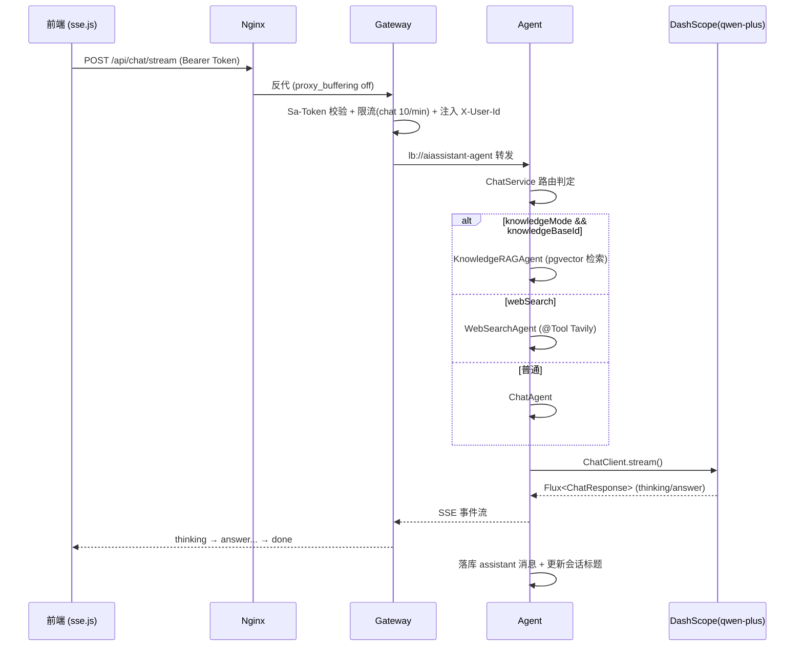
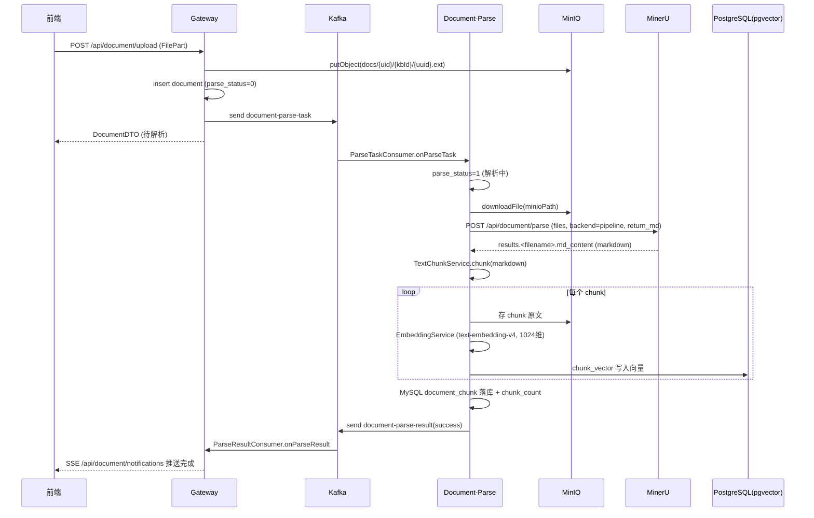

# AI Assistant

一个基于 **Spring Boot 3 + Spring Cloud Alibaba + Spring AI** 的多模块 AI 助手系统，提供流式对话、联网搜索、知识库（RAG）问答与文档解析入库能力。前端为 Vue 3 单页应用，后端由网关 + 智能体 + 文档解析三个微服务组成，通过 Nginx 统一对外暴露。

---

## 一、功能模块

| 模块 | 目录 | 端口 | 职责 |
| --- | --- | --- | --- |
| 网关 | `aiassistant-gateway` | 8080 | 统一入口、鉴权（Sa-Token）、限流、路由转发、文档上传、知识库 CRUD、解析结果 SSE 推送 |
| 智能体 | `aiassistant-agent` | 8081 | 流式对话、多 Agent 路由（普通/联网/知识库 RAG）、会话与消息管理 |
| 文档解析 | `aiassistant-document-parse` | 8082 | 消费解析任务、调用 MinerU 解析、文本切块、向量化、入库（MySQL + pgvector） |
| 公共库 | `aiassistant-common` | - | 共享实体（entity）、DTO、统一响应 `R`、错误码、全局异常处理 |
| 前端 | `aiassistant-frontend` | 80(经 Nginx) | Vue3 + Pinia + Element Plus，对话界面、知识库面板、SSE 流式渲染 |
| 压测 | `aiassistant-test` | - | Python + aiohttp 高并发压测脚本（登录/注册/对话/文档解析） |

### 对外 REST 接口一览

**鉴权（网关）**
- `POST /api/auth/register` 注册
- `POST /api/auth/login` 登录（返回 Sa-Token）
- `POST /api/auth/logout` 登出

**文档（网关）**
- `POST /api/document/upload` 上传文档（`multipart/form-data`，`FilePart`）
- `GET /api/document/status/{documentId}` 查询解析状态
- `GET /api/document/list` 按知识库列文档
- `DELETE /api/document/{documentId}` 删除文档
- `GET /api/document/notifications` 解析结果通知（SSE 长连接）

**知识库（网关）**
- `POST /api/knowledge-base` 创建
- `GET /api/knowledge-base/list` 列表
- `DELETE /api/knowledge-base/{id}` 删除

**对话（智能体，经网关转发）**
- `POST /api/chat/stream` 流式对话（SSE，事件类型 `thinking`/`answer`/`done`/`error`）

**会话/消息（智能体）**
- `GET /api/conversation/list` 会话列表
- `GET /api/conversation/list-by-kb` 按知识库列会话
- `PUT /api/conversation/{id}/title` 重命名
- `DELETE /api/conversation/{id}` 删除
- `GET /api/conversation/{conversationId}/messages` 历史消息

**文档解析（文档解析模块 / MinerU）**
- `POST /api/document/parse` 文档解析入口；经 Nginx 转发到 MinerU 的 `/file_parse`

---

## 二、系统整体架构

```
                          ┌──────────────┐
      浏览器 (Vue3 SPA) ──▶│   Nginx :80  │  静态资源 + 反向代理 + IP 限流
                          └──────┬───────┘
                                 │  /api/**
                                 ▼
                     ┌───────────────────────┐
                     │  Gateway :8080        │  Sa-Token 鉴权 / RateLimitFilter
                     │  (Spring Cloud GW)    │  TraceId / UserIdHeader 注入
                     └───┬───────────────┬───┘
        /api/chat/**     │               │  /api/document/parse
        /api/conversation│               ▼
                         ▼        ┌────────────────────┐
              ┌────────────────┐  │ Document-Parse:8082│
              │  Agent :8081   │  │  MinerU/切块/向量化 │
              │  ChatAgent     │  └───┬───────────┬────┘
              │  WebSearchAgent│      │           │
              │  KnowledgeRAG  │      ▼           ▼
              └──┬─────┬─────┬─┘  ┌──────┐   ┌──────────┐
                 │     │     │     │MinIO │   │  MinerU  │(经 Nginx→:5000/5001)
                 ▼     ▼     ▼     └──────┘   └──────────┘
          ┌────────┐┌──────┐┌─────────┐
          │DashScope││Tavily││ pgvector│
          │(qwen)  ││ 搜索 ││ (PG)    │
          └────────┘└──────┘└─────────┘

   共享基础设施： MySQL(业务库) · Redis(会话/限流) · Nacos(注册/配置) · Kafka(异步任务)
```

### Kafka 异步解耦

- Topic `document-parse-task`：网关上传完成后投递 → 文档解析模块消费
- Topic `document-parse-result`：文档解析完成后投递 → 网关消费并经 SSE 推送前端

---

## 三、核心流程图

### 1. 流式对话（含 Agent 路由）



### 2. 文档上传 → 解析 → 入库 → 通知



---

## 四、中间件及版本

| 中间件 | 用途                         | 版本                                                                 |
| --- |----------------------------|--------------------------------------------------------------------|
| Nginx | 反向代理、静态资源、IP 限流、SSE 透传     | 1.29/1.24                                                          |
| MySQL | 业务库（用户、会话、消息、文档、知识库、chunk） | 8.0.46                                                             |
| Redis | Sa-Token 会话存储、网关限流计数       | 7.4.7                                                              |
| Nacos | 服务注册发现 + 配置中心              | 2.4.2                                                              |
| Kafka | 文档解析任务/结果异步解耦              | 3.6.2                                                              |
| MinIO | 原始文档与切块文本对象存储              | 8.5.9                                                              |
| PostgreSQL  | 向量数据库                      | 15                                                                 |
| pgvector | 向量存储与相似度检索扩展               | 0.5.0                                                              |
| MinerU | 文档解析（PDF→Markdown）         | 3.4.5， |

LLM API 提供商：DashScope

搜索引擎接入商：Tavily

MinerU Python 依赖见 `requirements.txt`：`mineru==3.4.5`、`modelscope==1.40.2`、`torch==2.7.0`、`torchvision==0.22.0`、`transformers==4.57.6`。

---

## 五、开发框架及版本

### 后端（`pom.xml`）

| 框架 | 版本 |
| --- | --- |
| JDK | 21 |
| Spring Boot | 3.3.4 |
| Spring Cloud | 2023.0.3 |
| Spring Cloud Alibaba | 2023.0.3.4 |
| Spring AI | 1.0.0 |
| Spring AI Alibaba (dashscope starter) | 1.0.0.2 |
| Sa-Token（gateway 用 reactor 版 / agent 用 servlet 版） | 1.37.0 |
| MyBatis-Plus (spring-boot3-starter) | 3.5.7 |
| MinIO Java SDK | 8.5.9 |
| pgvector Java | 0.5.0 |
| Lombok | 由 Spring Boot BOM 管理 |

> 注意：本项目使用**自定义父 POM**（`aiassistant-parent`），`spring-boot-maven-plugin` 只声明在 `<pluginManagement>`，**未绑定 `repackage` 执行**——详见「常见问题 1」。

### 前端（`aiassistant-frontend/package.json`）

| 库 | 版本 |
| --- | --- |
| Vue | 3.4.38 |
| Vite | 5.4.8 |
| Pinia | 2.2.2 |
| Vue Router | 4.4.3 |
| Element Plus | 2.8.4 |
| axios | 1.7.7 |
| @microsoft/fetch-event-source（SSE） | 2.0.1 |
| markdown-it / highlight.js | 14.1.0 / 11.10.0 |
| Node / npm（要求） | ≥18.18.0 / ≥9.2.0 |

### 压测（`aiassistant-test`）

Python 3.11 + `aiohttp`（见 `aiassistant-test/requirements.txt`），基于 `asyncio` + `TCPConnector(limit=0)` 实现真并发。

---

## 六、关键模块实现原理

### 1. 网关鉴权与用户上下文透传
- `SaTokenConfig` 注册 `SaReactorFilter`，`include /**`，放行 `/api/auth/login`、`/api/auth/register`、`/actuator/**`；未登录返回 401 JSON。
- Token 从请求头读取：`token-name=Authorization`、`token-prefix=Bearer`、`token-style=uuid`，会话存 Redis。
- `UserIdHeaderFilter` 校验登录后把 `userId` 写入下游请求头 `X-User-Id`，各后端 Controller 用 `@RequestHeader("X-User-Id")` 取用户身份，避免重复解析 Token。
- `TraceIdFilter` 注入链路 ID，便于日志排查。

### 2. 反向代理 & 限流

反向代理机制（配置见 `deploy/nginx/conf.d/api.conf`，Nginx 监听 `:80` 作为唯一对外入口）：

- **静态资源 + 代理一体**：`root /usr/share/nginx/html/api` 托管 Vue 构建产物；`/api/**` 反向代理到后端；SPA history 模式用 `location /` 的 `try_files $uri $uri/ /index.html` 回退。
- **两个 upstream**：`gateway_backend`(`127.0.0.1:8080`, `keepalive 64`) 承载绝大多数业务 API；`mineru_backend`(`127.0.0.1:5000`/`5001`, `keepalive 16`) 承载文档解析，两实例做负载。
- **location 按最长前缀优先匹配**，SSE / 上传 / 解析等专用 location 必须写在通用 `/api/` 之前：
  - `/api/chat/stream` → gateway：SSE 关键项 `proxy_buffering off`、`proxy_cache off`、`chunked_transfer_encoding on`、`proxy_read_timeout/proxy_send_timeout 300s`、`proxy_http_version 1.1` + `proxy_set_header Connection ""`（禁缓冲、保长连接，防断流）。
  - `/api/document/notifications` → gateway：解析结果长连接通知，超时放宽到 `3600s`。
  - `/api/document/parse` → `mineru_backend/file_parse`：`client_max_body_size 100m`。
  - `/api/document/upload` → gateway：`client_max_body_size 100m`（默认全局 `50m`）。
  - `/api/` → gateway：通用业务 API 兜底代理。
  - `/nginx-health` → 直接返回 200，供探活。
- **统一透传头**：`Host`、`X-Real-IP`、`X-Forwarded-For`、`X-Forwarded-Proto`，让网关与下游拿到真实客户端 IP 与协议。
- **安全**：`location ~ /\.` 一律 `deny all`，禁止访问隐藏文件；`error_page 429 @rate_limited` 返回统一 JSON。

限流机制：

- **Nginx 层**：`limit_req_zone` 基于 `$binary_remote_addr`，`100r/s`，超限返回 429 JSON；SSE/上传 location 单独放宽 burst。
- **网关层**：`RateLimitFilter`（`GlobalFilter`，order=-150）基于 `X-User-Id` + 路径前缀，用 Reactive Redis `increment + expire` 计数。`/api/chat/stream` 限 **10 次/分钟**，其余 **60 次/分钟**，超限返回 429。

### 3. 多 Agent 路由（`ChatService`）
优先级：**知识库 RAG > 联网搜索 > 普通对话**。
```
if (knowledgeMode && knowledgeBaseId != null) → KnowledgeRAGAgent
else if (webSearch)                           → WebSearchAgent
else                                          → ChatAgent
```
- 所有 Agent 统一用 `ChatClient.builder(chatModel).build().prompt().messages(...).options(...).stream().chatResponse()` 返回 `Flux<ChatResponse>`。
- `deepThink` 开启时通过 `options` 打开思考模式；思考内容通过 `response.getMetadata().get("thinking")` 判定，映射为 `thinking` 事件。
- `ChatService` 负责：创建/绑定会话、保存 user 消息、取最近 20 条上下文、聚合 `answer` 内容落库、补发 `done` 事件、`onErrorResume` 转 `error` 事件。

### 4. WebSearchAgent（Tavily 联网搜索）
- `WebSearchService` 用 Spring `RestClient` POST 到 `https://api.tavily.com/search`，Header `Authorization: Bearer <TAVILY_API_KEY>`，body 含 `query/search_depth/max_results/include_answer`。
- `WebSearchTool` 是普通类（非 Bean），以 `@Tool(name="webSearch")` + `@ToolParam` 暴露给大模型；**由 LLM 自主决定是否调用并把用户问题改写为独立查询**。
- 配置在 `ai.websearch.*`（`WebSearchProperties`），apiKey 为空时返回“联网搜索未配置”，异常时降级返回“联网搜索暂时失败”，不阻断对话。

### 5. 知识库 RAG
- `KnowledgeRetrievalService` / `KnowledgeRetrievalTool` 基于 pgvector 做向量相似度检索，召回 `RetrievedChunk` 拼进 Prompt 上下文，再由模型作答。
- 向量维度固定 1024，需与入库时的 embedding 模型（`text-embedding-v4`）一致。

### 6. 文档解析异步流水线（`DocumentParseService`）
分步带日志（`STEP 0~6`）：`标记解析中 → 从 MinIO 下载 → 调 MinerU 解析 → 切块 → 落库(MinIO chunk 原文 + MySQL document_chunk + embedding + PG chunk_vector) → 发送成功/失败结果`。
- **MinerU 契约（3.4.5）**：请求 `/file_parse`，字段名 `files`，附加 `backend=pipeline`、`return_md=true`；响应把 markdown 嵌套在 `results.<filename>.md_content`（**不是**顶层扁平字段）。`MinerUService` 用 `firstFileResult()` 兼容嵌套与旧版扁平两种结构。
- **双数据源**：MySQL（业务元数据）与 PostgreSQL（向量）分别配置 `spring.datasource` 与 `spring.pg-datasource`，`PgVectorConfig` + `ChunkVectorMapper`/`VectorTypeHandler` 处理 pgvector 类型映射。
- 任一步失败：置 `parse_status=3`、记录 `parse_error`、经 Kafka 发送失败结果。

### 7. 前端 SSE 流式渲染
- `src/utils/sse.js` 基于 `@microsoft/fetch-event-source`，携带 Bearer Token 发起 `POST /api/chat/stream`，逐事件渲染 `thinking`/`answer`。
- 设置 `openWhenHidden: true`，避免浏览器标签页切到后台（`document.hidden===true`）时连接被库主动关闭导致断流。
- 状态管理用 Pinia（`store/modules/{user,chat,conversation,knowledge}.js`）。

---

## 七、快速开始

### 1. 准备中间件
启动 MySQL、Redis、Nacos、Kafka、MinIO、PostgreSQL(pgvector)、MinerU，并执行初始化脚本：
- `deploy/mysql/01-init.sql`
- `deploy/postgresql/01-init.sql`
- Nginx：`deploy/nginx/conf.d/api.conf`

### 2. 配置环境变量
```bash
cp .env.template .env
vim .env   # 填写 MySQL/Redis/Nacos/Kafka/MinIO/PG/DASHSCOPE_API_KEY/TAVILY_API_KEY
```

### 3. 构建并启动后端（Linux）
```bash
bash start-all.sh --build   # 首次：mvn clean install + 每模块 package spring-boot:repackage，产出可执行 fat jar 后启动
bash start-all.sh           # 之后：直接跑现有 jar（默认 --skip-build）
bash start-all.sh status    # 查看运行状态（PID 探活）
bash start-all.sh stop      # 停止全部
bash start-all.sh restart   # 重启（认 --build）
```
- 日志：`logs/<module>.log`；PID：`.pids/<module>.pid`。

### 4. 前端
```bash
cd aiassistant-frontend
npm install
npm run dev      # 开发
npm run build    # 产物部署到 Nginx root (/usr/share/nginx/html/api)
```

### 5. 压测
```bash
cd aiassistant-test
pip install -r requirements.txt   # aiohttp
python run_all.py --base-url http://127.0.0.1:80
python run_all.py --only chat     # 仅跑某一类
```
- 登录：10/100/1000 并发，阈值 5s；注册/对话：10/100 并发，阈值 10s；文档解析：1/10 并发，阈值 40s。
- 对话以「首字时延」为指标，压测前建议放宽/关闭网关与 Nginx 限流。
- 命中 429（超限）的请求会被记录，退避 2s 后重跑，最多 3 轮。

---

## 八、常见问题（结合开发过程总结）

### 1. `no main manifest attribute` / jar 无法执行
**根因**：本项目用自定义父 POM，`spring-boot-maven-plugin` 未绑定 `repackage`，`mvn package`/`install` 只产出**瘦 jar**（无 `Main-Class`）。`start-all.sh` 默认 `--skip-build`，会直接跑到 `target/` 里遗留的瘦 jar。
**解决**：首次务必 `bash start-all.sh --build`；其内部对每个可运行模块执行 `mvn -pl <module> -DskipTests package spring-boot:repackage`。
**校验**：`unzip -p xxx.jar META-INF/MANIFEST.MF` 应含 `Main-Class: org.springframework.boot.loader.launch.JarLauncher` 与 `Start-Class`；repackage 成功后 `target/` 会留 `*.jar.original`。

### 2. `spring-boot:repackage ... Source file is not available`
**根因**：`repackage` 作为命令行目标（default-cli）在没有执行 `package` 阶段的 invocation 中单独运行，`project.getArtifact().getFile()` 为 null。
**解决**：`package` 与 `spring-boot:repackage` 必须写在**同一条 mvn 命令**里，例如 `mvn -pl aiassistant-agent -DskipTests package spring-boot:repackage`。

### 3. 启动脚本报 `JAVA_OPTS: unbound variable`
**根因**：`set -u` 下引用了未默认化的 `JAVA_OPTS`。
**解决**：脚本已用 `export JAVA_OPTS="${JAVA_OPTS:--Xms256m -Xmx512m}"` 兜底。

### 4. MinerU 解析成功但 markdown 为空
**根因**：MinerU 3.4.5 把结果嵌套在 `results.<filename>.md_content`，若按顶层扁平字段取会得到空。
**解决**：`MinerUService` 已用 `firstFileResult()` 优先取嵌套结构、回退旧版扁平结构。升级 MinerU 4.x 时接口变为 `/v1` 且返回 ZIP，需要相应改造。

### 5. 对话流式中断 / 切后台断流
**根因**：`@microsoft/fetch-event-source` 默认 `openWhenHidden=false`，标签页隐藏（`document.hidden===true`）时会主动关连接。
**解决**：`sse.js` 已设 `openWhenHidden: true`。此外 Nginx 的 `/api/chat/stream` location 必须 `proxy_buffering off` + `proxy_read_timeout 300s`，否则会出现缓冲/超时导致的断流与重复 re-POST。

### 6. 请求频繁 429
**根因**：双层限流——Nginx `100r/s`（IP 维度）+ 网关 `RateLimitFilter`（用户维度，chat 10/min、其余 60/min）。
**解决**：压测前放宽或临时关闭限流；生产环境按业务调整 `RateLimitFilter` 常量与 Nginx `limit_req_zone`。

### 7. 双数据源相关报错（PG / pgvector）
**根因**：MySQL 与 PostgreSQL 需分别通过 `spring.datasource` 与 `spring.pg-datasource` 配置；pgvector 列需要自定义 `VectorTypeHandler`。
**解决**：确认 `PgVectorConfig`/`DataSourceConfig` 生效，向量维度（1024）与 embedding 模型输出一致，PG 侧唯一约束避免重复写入。

### 8. 网关 401 / X-User-Id 缺失
**根因**：下游服务依赖网关注入的 `X-User-Id`；直连后端（绕过网关）或 Token 过期都会导致 401 或 `X-User-Id` 为空。
**解决**：所有请求经 Nginx→网关，携带 `Authorization: Bearer <token>`；确认 Redis 中 Sa-Token 会话有效。

---

## 九、目录结构速览

```
AIAssistant/
├── aiassistant-common/          共享 entity/dto/result/exception
├── aiassistant-gateway/         网关(8080): 鉴权/限流/路由/上传/通知
├── aiassistant-agent/           智能体(8081): ChatAgent/WebSearchAgent/KnowledgeRAGAgent
├── aiassistant-document-parse/  文档解析(8082): MinerU/切块/向量化/入库
├── aiassistant-frontend/        Vue3 前端
├── aiassistant-test/            Python 压测
├── deploy/                      nginx / mysql / postgresql 初始化脚本
├── docs/                        设计文档
├── .env.template                环境变量模板
├── requirements.txt             MinerU Python 依赖
├── start-all.sh                 Linux 一键启动脚本
└── pom.xml                      多模块父 POM
```
